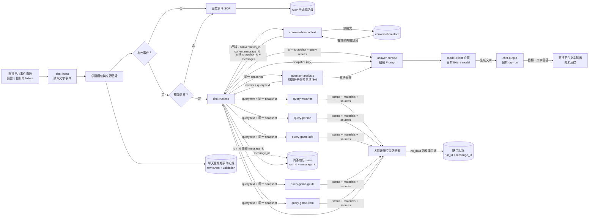
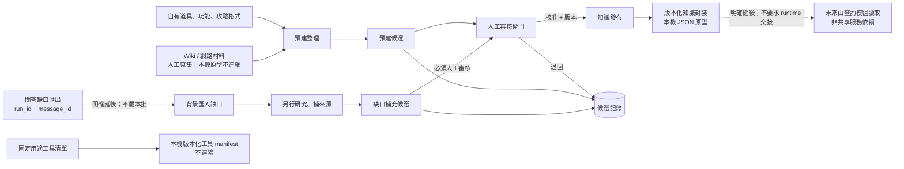
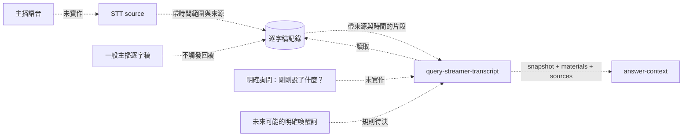
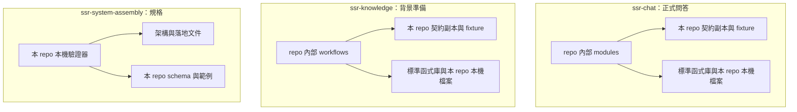

# 架構與資料流

本文件把正式問答資料流、背景知識流程、明確延後的 STT 路徑與 repo 依賴圖分開。圖描述三 repo 邊界；目前外部平台、正式模型及網路 provider 未連線。跨 repo 交換／整合與 STT 已明確延後，不是本批缺口。

## 正式問答：輸入到平台文字輸出

每筆事件先保留原始輸入及驗證結果。invalid、未觸發與 loop guard 事件進入固定 SOP 記錄，不直接丟棄，也不產生公開回答。

`conversation-context` 的完整回程是 Runtime 呼叫 context、context 讀 conversation-store、store 回前文、context 回 snapshot 給 Runtime。Runtime 把同一 snapshot 交給分析與 answer-context；分析後的用途和各查詢素材也回到 answer-context，然後才送入模型。每個 query response 的最小內容是 `status`、`materials`、`sources`；診斷細節留在執行 trace。

聊天室原始事件、SOP、問答執行 trace、知識缺口是不同記錄。只有實際進入問答執行的事件有 `run_id`；執行 trace 以 `run_id` 連結對應的 `message_id`。SOP 處置細節仍待決定。

### 背景知識流程

知識準備是獨立系統，預建、缺口研究和工具設定不要求聊天 runtime 運行，也不假設共用資料庫。人物／遊戲資料的來源方向已定為自有資料格式及人工整理的 Wiki／網路材料；本機只接收已整理的 JSON 與 fixture，不執行網路抓取。人物、遊戲和天氣的正式 provider 尚未連線；跨 repo 發布資料如何交付給 query modules 明確延後，不是目前 runtime 前置條件。

缺口補充候選必須人工審核後才能發布。預建內容是否一律人工審核尚待決定；本機原型先採人工審核的保守預設。工具設定可在本機保存及讀回不可變版本 manifest，內容列 adapter kind、介面版本、參數和輸出；provider 仍 undecided，network disabled，不執行工具也不儲存金鑰。跨 repo 版本封裝、匯入與相容政策已明確延後。

## 明確延後：STT 資料路徑（尚未實作）

若未來重新排入，逐字稿資料需帶來源與起訖時間；一般逐字稿不觸發回覆。喚醒詞、保留政策、來源及實作 repo 屆時再決定。此圖不是當前運行路徑，也不屬本批完成條件。

## 純 repo 依賴圖

三個 repo 之間沒有 import、檔案路徑、共用 runtime 或 DB 依賴。本批不建立共享套件、資料封裝或整合服務；若日後使用者重新排入共用能力，再決定版本化依賴，不因此要求共用運行服務。契約副本獨立維護；修改時需在各 repo 各自更新和驗證。

本機延伸的去重、模型／輸出失敗路徑，以及研究包與發布完整性流程，另見 [local-extension-acceptance.md](local-extension-acceptance.md)。流程圖與 repo 純依賴圖仍分開呈現。
