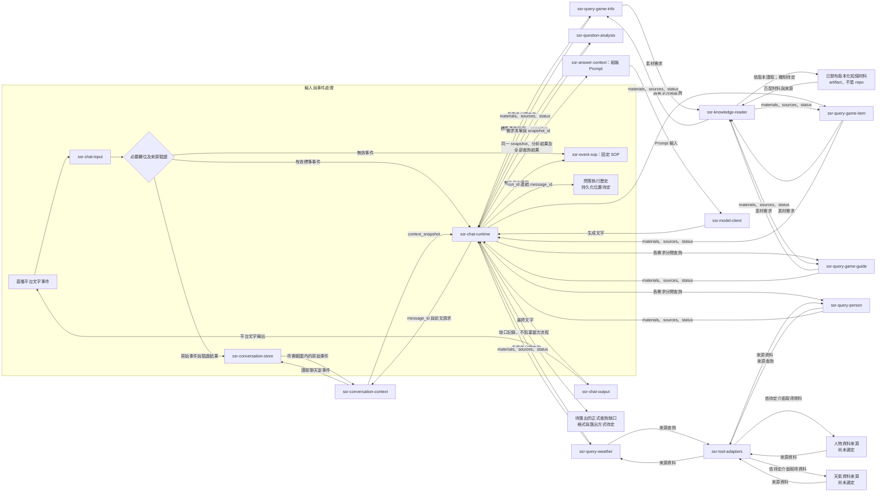
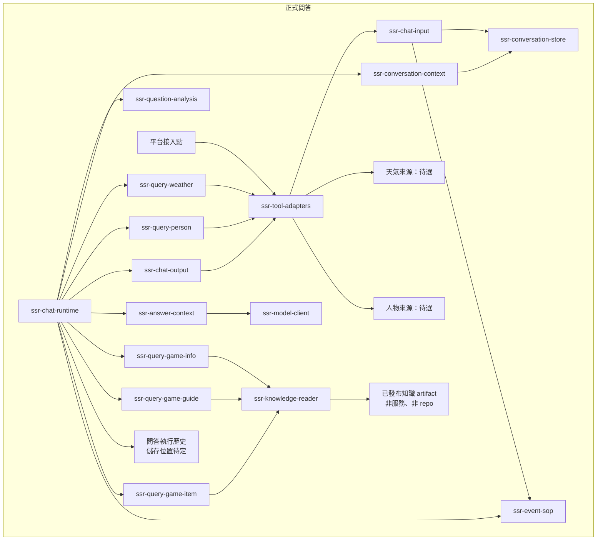
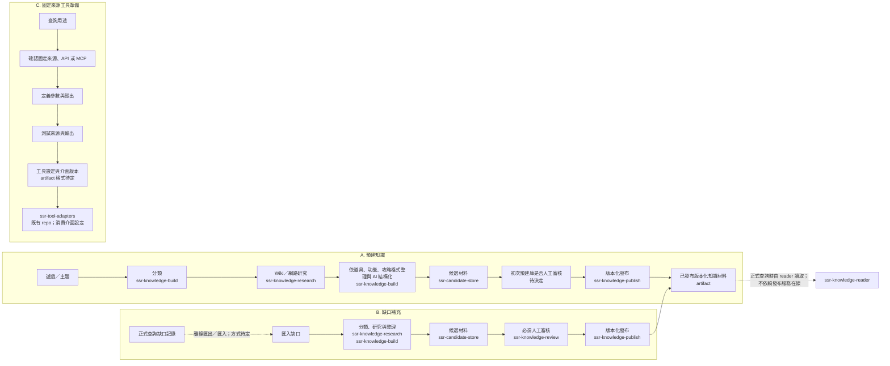

# 架構草圖

本文件描述目標邊界，不表示任何真實平台、服務、來源或端到端流程已完成。Repo 名稱代表責任邊界；圖中的 artifact 是資料產物，不是 repo 或常駐服務。標為待定的呼叫與存取方式是待設計介面，不是已驗證實作。

## 正式問答資料流

圖中箭頭表示資料、請求或結果的傳遞；正式問答內的所有讀取都畫出回傳路徑。

### 前文與素材回傳到 Prompt

1. chat-input 保留原始事件和驗證結果。無效事件交固定 SOP；有效標準事件才交 runtime 判斷是否觸發。有效但未觸發的事件也交固定 SOP。
2. runtime 呼叫 conversation-context；context 讀 conversation-store 的聊天室事件，建立 snapshot 並回傳 runtime。原始聊天室事件與問答執行歷史分開記錄，run_id 連結 message_id；執行歷史的持久化位置尚未決定。
3. runtime 將同一份 context_snapshot 傳給 question-analysis 和 answer-context。分析結果帶 snapshot_id；answer-context 收到原 snapshot、分析結果及每項查詢的 materials、sources、status。
4. 遊戲介紹、攻略及道具查詢分別讀取 knowledge-reader。reader 讀取已發布版本化材料 artifact，並將材料與來源回傳各自的 query；query 再把 materials、sources、status 回傳 runtime。
5. 天氣與人物查詢透過 tool-adapters 取得來源資料，再各自回傳 materials、sources、status。實際來源、介面與設定方式未選定。
6. runtime 將同一份 snapshot、分析結果和全部查詢結果交給 answer-context；Prompt 才交 model-client。查詢未命中或不可用的 status 也走這條路徑。資料不足時留下缺口記錄，缺口匯出不阻塞當次問答。

## 正式呼叫與資料存取依賴

此圖與上方資料流分開。箭頭由呼叫者指向被呼叫能力；指向 artifact 或外部來源的箭頭表示資料存取方向。回傳內容在資料流圖呈現。這是目標呼叫邊界，協定與部署方式尚未選定。

正式查詢只讀已發布知識 artifact，不呼叫 knowledge-publish，也不要求背景系統或發布服務在線。reader 的 artifact 格式、版本定位與讀取協定尚待決定。工程共用的純契約相容圖另見 repo 清單文件；該圖只表示契約依賴，不取代本節的呼叫／資料存取關係。

## 背景知識與工具準備資料流

兩個知識流程接到同一個已發布材料 artifact 節點，只表示產物類型相同；不預設共用儲存位置、資料庫或常駐發布服務。以下三個工作流可各自執行，也可彼此並行；不要求同時啟動、共用一個排程或排成一條序列。重複出現的 repo 名稱表示重用其能力，不表示共用資料庫、常駐服務、單一程序或全域序列佇列。

預建知識依主題分類、研究 Wiki／網路材料，再整理成道具、功能、攻略等格式並形成候選材料；初次預建庫是否需要人工審核仍未決定。正式查詢缺口另行匯入研究，缺口補充必須經人工審核才能發布。兩者只透過版本化發布材料銜接正式 reader；正式問答不要求背景流程運行，背景工作也不要求正式 runtime 運行。

固定來源工具準備是獨立工作流，不新增 repo。它為查詢用途確認來源/API/MCP、參數與輸出、測試方式，並形成待定格式的工具設定及介面版本，供既有 tool-adapters 使用。來源、credentials、介面版本管理與設定交付方式都尚未選定。

## 尚未實作及未決範圍

所有 repo（除已建立的文件 repo 外）和服務均為藍圖，沒有真實平台、模型、天氣／人物來源或知識來源連線，也沒有端到端驗證。conversation-store、問答執行歷史、candidate-store 與已發布 artifact 的存放方式、schema 相容政策、資料保留及協定均未選定。兩個 STT repo 仍只作預留，未建立、未實作；詳見 repo 清單及待決策事項。
