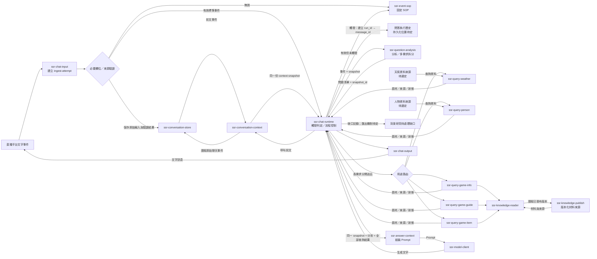
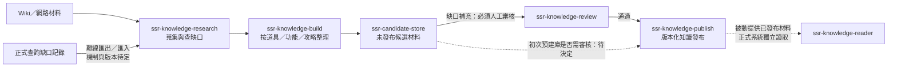

# 架構草圖

本文件分開描述資料流、背景知識流與版本化 repo 依賴。圖示是目標設計，沒有代表現有平台或服務已完成部署。

## 正式問答資料流

### 前文與查詢資料回傳路徑

1. `chat-input` 先保留原始輸入與驗證結果。無效輸入即送 SOP；有效標準事件才交 runtime 判斷觸發。事件與執行歷史分開記錄。
2. runtime 呼叫 `conversation-context`；它讀 `conversation-store` 的聊天室事件，收到事件後建立 snapshot 並回傳 runtime。
3. runtime 把這份 snapshot 傳給 question-analysis。分析輸出保留 `context_snapshot_id`。
4. runtime 對每個拆出的需求呼叫獨立用途查詢器。遊戲資料查詢透過 knowledge-reader 讀取已發布版本；天氣與人物來源的實際存取方式尚未選定。
5. 各查詢器只回 `materials`、`sources`、`status`。結果不直接回覆觀眾；runtime 將它們連同原 snapshot 與分析輸入交 answer-context。
6. answer-context 組成 Prompt 後才交 model-client。此路徑讓前文和每項已讀材料都可追到 Prompt 輸入；查詢未命中／不可用狀態也會交給組裝端。

`conversation-store` 的實際儲存位置、前文範圍、snapshot 是否含當前訊息、外部來源與發布材料的讀取協定均未選定。圖中發布來源與 query modules 代表邏輯邊界，並非共用資料庫或常駐服務承諾。

## 背景知識資料流

正式問答與背景作業是不同運作單位，不要求同時啟動，也不假設共享 DB。正式查詢發現材料不足時留下缺口，背景工作之後另行研究；缺口補充須人工審核才發布。初次預建庫的審核政策未決定。確切的問題匯出、候選材料格式、版本發布和正式讀取機制待定。

## 純版本化依賴圖

以下只表示程式／契約依賴，不表示資料流、服務呼叫、同一部署或共用運行服務。箭頭方向為「左側 repo 依賴右側契約」，實際版本號與 package 管理方式待決定。

```mermaid
flowchart BT
  Contracts[ssr-data-contracts\n版本化 schema 套件]
  subgraph Formal[正式 repo 契約依賴]
    ChatInput[ssr-chat-input]
    Runtime[ssr-chat-runtime]
    Analysis[ssr-question-analysis]
    Context[ssr-conversation-context]
    AnswerContext[ssr-answer-context]
    Output[ssr-chat-output]
    Store[ssr-conversation-store]
    SOP[ssr-event-sop]
    Reader[ssr-knowledge-reader]
    Weather[ssr-query-weather]
    Person[ssr-query-person]
    GameInfo[ssr-query-game-info]
    Guide[ssr-query-game-guide]
    Item[ssr-query-game-item]
  end
  subgraph Background[背景 repo 契約依賴]
    Build[ssr-knowledge-build]
    Research[ssr-knowledge-research]
    Review[ssr-knowledge-review]
    Publish[ssr-knowledge-publish]
    Candidate[ssr-candidate-store]
  end
  subgraph Common[工程共用 repo]
    Model[ssr-model-client]
    Adapters[ssr-tool-adapters]
  end
  ChatInput --> Contracts
  Runtime --> Contracts
  Analysis --> Contracts
  Context --> Contracts
  AnswerContext --> Contracts
  Output --> Contracts
  Store --> Contracts
  SOP --> Contracts
  Reader --> Contracts
  Weather --> Contracts
  Person --> Contracts
  GameInfo --> Contracts
  Guide --> Contracts
  Item --> Contracts
  Build --> Contracts
  Research --> Contracts
  Review --> Contracts
  Publish --> Contracts
  Candidate --> Contracts
  Model --> Contracts
  Adapters --> Contracts
  Assembly[ssr-system-assembly\n記錄版本相容組合] -.->|記錄目標組合，不是執行依賴| Contracts
```

`ssr-system-assembly` 描述版本組合與架構，不能因此推論它是 runtime。未來逐字稿兩個預留 repo 尚未建立，也未納入此目標圖。
