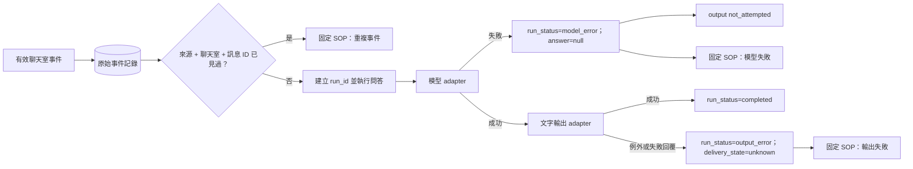
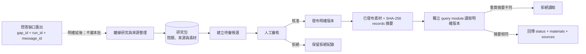

# 本機延伸契約與驗收

本文件補充目前三個 repo 的本機功能。這些資料流和契約只說明各 repo 內部如何運作；不表示真實平台、遠端模型或外部查詢已經連線。跨 repo 傳輸／整合與 STT 已明確延後，不是本批驗收條件。

## 正式問答：重複事件與失敗追蹤

原始事件先記錄，之後以 `source + conversation_id + message_id` 去重。重複事件保留在原始事件日誌並交給固定 SOP，不建立第二筆問答 run。已記錄事件可在重啟後重建去重索引；多程序同時寫入的原子性尚未實作。模型失敗會建立 run trace、寫入 SOP，且不呼叫輸出 adapter。輸出 adapter 例外時記錄 `delivery_state=unknown`，不自動重送。

輸入缺少穩定 `message_id` 時不再生成隨機替代值，而是驗證失敗並進 SOP。問題分析以本機分隔符和關鍵字規則產生一項或多項 purpose-specific query text，再分別呼叫對應模組；它不是語意模型，未被分隔的多用途子句可能同時交給多個模組。

## 背景知識：獨立研究包與發布完整性

研究包、候選、發布素材分開保存。研究包記錄 gap/run/message 的關聯和來源；由研究包 ID 才能建立待審候選。只有人工核准的候選才能發布。讀取端須檢查 `publication_status=published` 及 records 的 SHA-256 摘要。摘要只偵測意外或未授權的內容變動，不是數位簽章，也不證明來源真實性。跨 repo 缺口匯出、資料傳輸與版本交接已明確延後；本機工作流不依賴它們。

## Repo 內契約與驗收範圍

- `ssr-chat` 自己驗證事件記錄、重啟去重、聊天室隔離、已發布素材邊界，以及模型／輸出失敗 trace；任何有效輸出均由本 repo 的 adapter contract 表示。
- `ssr-knowledge` 自己驗證離線研究包、證據非空、候選人工審核、明確版本及發布摘要重驗。
- `ssr-system-assembly` 只驗證本 repo 自有 JSON Schema、範例、文件和 repo 清單。各 repo 各自複製並維護所需契約，不由共同 repo 匯入 schema 或程式碼。
- STT／逐字稿來源與 query 明確延後；目前沒有逐字稿輸入、保存或 query 實作，一般逐字稿不觸發回覆。
- 預建知識是否也必須人工審核仍待決定；本機版本採人工核准才發布的保守預設。
