# Repo 清單與責任邊界

狀態欄代表落地進度：**首批已公開**表示 repo 已在 HGPT-StreamSuite 以 Public、main 建立；**藍圖**代表只列入系統規劃，尚未建立 repo。名稱與 repo 數以核心 23 個為準，兩個 STT repo 另列為預留項目。

## 正式問答系統（14）

| Repo | 責任邊界 | 狀態 |
|---|---|---|
| ssr-chat-input | 接收平台文字事件、標準化輸入、必要欄位及來源驗證，保留無效輸入送 SOP。 | 藍圖 |
| ssr-chat-runtime | 控制觸發、SOP 路由、前文讀取、分析、查詢、Prompt、模型和輸出的單次流程；建立問答 run_id 與獨立執行歷史記錄。 | 藍圖 |
| ssr-question-analysis | 判斷問題意圖、拆分多需求，為每個需求指定獨立查詢用途。 | 藍圖 |
| ssr-conversation-context | 由 runtime 呼叫；讀取 conversation-store 並回傳前文快照。 | 藍圖 |
| ssr-answer-context | 組合分析、各查詢素材與 runtime 傳入的同一前文快照，產生模型 Prompt 輸入。 | 藍圖 |
| ssr-chat-output | 將完成的文字交回平台 adapter；不負責查詢或生成答案。 | 藍圖 |
| ssr-conversation-store | 儲存／讀取原始聊天室事件，供 context 建立快照。 | 藍圖 |
| ssr-event-sop | 接收無效事件與有效但未觸發事件，依固定 SOP 處理，不靜默丟棄。 | 藍圖 |
| ssr-knowledge-reader | 將已發布、版本化知識材料 artifact 轉為查詢可用素材；artifact 讀取協定待定，不依賴發布服務在線。 | 藍圖 |
| ssr-query-weather | 獨立處理天氣需求，僅回素材、來源與狀態。 | 藍圖 |
| ssr-query-person | 獨立處理人物需求，僅回素材、來源與狀態。 | 藍圖 |
| ssr-query-game-info | 獨立處理遊戲介紹需求，僅回素材、來源與狀態。 | 藍圖 |
| ssr-query-game-guide | 獨立處理遊戲攻略需求，僅回素材、來源與狀態。 | 藍圖 |
| ssr-query-game-item | 獨立處理道具需求，僅回素材、來源與狀態。 | 藍圖 |

## 背景知識準備系統（5）

此系統可獨立研究、整理及發布知識。預建知識、正式缺口補充及固定來源工具準備是可各自執行的工作流；可並行安排，但不要求同時啟動或共用一個序列程序。正式問答缺資料時可留下缺口，並透過待定的匯出／匯入機制交背景研究。正式問答不需要背景系統運行，背景作業也不要求正式問答運行。

| Repo | 責任邊界 | 狀態 |
|---|---|---|
| ssr-knowledge-build | 按道具、功能與攻略等目錄，整理 Wiki／網路材料成為候選知識；支援預建與缺口材料結構化。 | 藍圖 |
| ssr-knowledge-research | 研究 Wiki／網路材料，追查正式查詢留下的資料缺口。 | 藍圖 |
| ssr-knowledge-review | 對正式缺口補充進行必須的人工審核；初次大批預建庫是否需審核尚未決定。 | 藍圖 |
| ssr-knowledge-publish | 發布版本化知識材料 artifact；正式 reader 讀取 artifact，不要求此 repo 作為服務在線。 | 藍圖 |
| ssr-candidate-store | 保存整理中、尚未發布的候選材料；存放機制未選定。 | 藍圖 |

## 工程共用（4）

| Repo | 責任邊界 | 狀態 |
|---|---|---|
| ssr-model-client | 封裝模型呼叫；供應商、API、重試及安全政策待定。 | 藍圖 |
| ssr-tool-adapters | 封裝平台、固定網路來源與其他工具 adapter；可消費經測試的工具設定／介面版本，實際協定待定。 | 藍圖 |
| ssr-data-contracts | 共用且版本化的資料契約、schema、範例與驗證；不提供執行服務。 | 首批已公開 |
| ssr-system-assembly | 保存 repo 藍圖、流程、版本相容組合及落地計畫；不提供執行服務。 | 首批已公開 |

## 預留（不計入 23 個）

| Repo | 預留用途 | 狀態 |
|---|---|---|
| ssr-streamer-transcript-source | 未來主播逐字稿含時間與來源入庫。 | 未實作、未建立 |
| ssr-query-streamer-transcript | 未來獨立查詢「剛剛說了什麼」等逐字稿需求。一般逐字稿不觸發問答；明確喚醒詞若採用須另行設計。 | 未實作、未建立 |

共用能力透過版本化依賴共享契約，不代表共用資料庫或常駐服務。原始聊天室事件與問答執行歷史分開記錄，run_id 連結 message_id；執行記錄由 runtime 邏輯產生，實際持久化位置與技術待定。

## 工程補充：契約版本相容性

下表是版本相容性規劃框架，不是已選定的契約版本。消費者與精確契約項目仍須按介面確認。

| 契約資料面 | 候選 consumer repo | 契約版本 | 狀態 |
|---|---|---|---|
| 平台輸入、標準事件、驗證結果、SOP 事件 | ssr-chat-input、ssr-conversation-store、ssr-event-sop、ssr-chat-runtime | 待定 | 目標相容關係 |
| 前文 snapshot、分析需求、用途路由、查詢結果、Prompt、模型結果、run record | ssr-conversation-context、ssr-question-analysis、五個 ssr-query-*、ssr-answer-context、ssr-model-client、ssr-chat-output、ssr-chat-runtime | 待定 | 目標相容關係 |
| 候選材料、審核結果、發布 metadata、缺口記錄 | ssr-knowledge-build、ssr-knowledge-research、ssr-candidate-store、ssr-knowledge-review、ssr-knowledge-publish、ssr-knowledge-reader | 待定 | 目標相容關係 |
| 工具參數、工具輸出、來源 metadata | ssr-tool-adapters、ssr-query-weather、ssr-query-person、遊戲 query repos | 待定 | 目標相容關係 |

下面只畫版本化契約相容關係，不是整體 repo 依賴圖；它不涵蓋 runtime 呼叫、資料存取、部署或流程先後。箭頭表示 consumer repo 依賴 ssr-data-contracts 的契約；版本及套件發布方式未定。ssr-system-assembly 只記錄目標相容組合，不是執行依賴。

```mermaid
flowchart BT
  Contracts["ssr-data-contracts<br/>契約版本待定"]
  subgraph Formal["正式 repo 契約 consumer"]
    ChatInput["ssr-chat-input"]
    Runtime["ssr-chat-runtime"]
    Analysis["ssr-question-analysis"]
    Context["ssr-conversation-context"]
    AnswerContext["ssr-answer-context"]
    Output["ssr-chat-output"]
    Store["ssr-conversation-store"]
    SOP["ssr-event-sop"]
    Reader["ssr-knowledge-reader"]
    Weather["ssr-query-weather"]
    Person["ssr-query-person"]
    GameInfo["ssr-query-game-info"]
    Guide["ssr-query-game-guide"]
    Item["ssr-query-game-item"]
  end
  subgraph Background["背景 repo 契約 consumer"]
    Build["ssr-knowledge-build"]
    Research["ssr-knowledge-research"]
    Review["ssr-knowledge-review"]
    Publish["ssr-knowledge-publish"]
    Candidate["ssr-candidate-store"]
  end
  subgraph Common["工程共用 repo"]
    Model["ssr-model-client"]
    Adapters["ssr-tool-adapters"]
  end
  ChatInput --> Contracts
  Runtime --> Contracts
  Analysis --> Contracts
  Context --> Contracts
  AnswerContext --> Contracts
  Output --> Contracts
  Store --> Contracts
  SOP --> Contracts
  Reader --> Contracts
  Weather --> Contracts
  Person --> Contracts
  GameInfo --> Contracts
  Guide --> Contracts
  Item --> Contracts
  Build --> Contracts
  Research --> Contracts
  Review --> Contracts
  Publish --> Contracts
  Candidate --> Contracts
  Model --> Contracts
  Adapters --> Contracts
  Assembly["ssr-system-assembly"] -.->|"記錄相容組合，不是執行依賴"| Contracts
```

